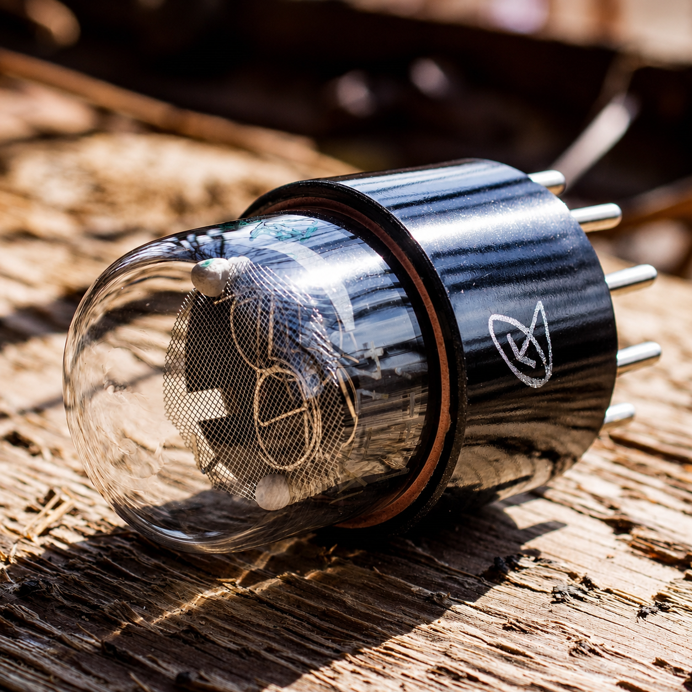
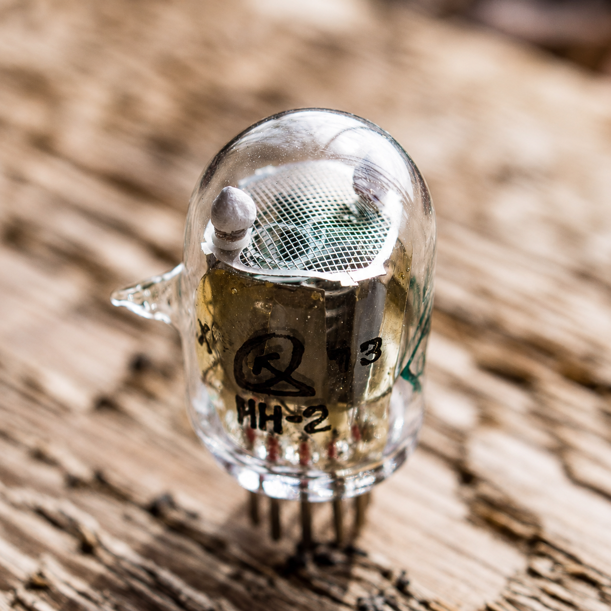
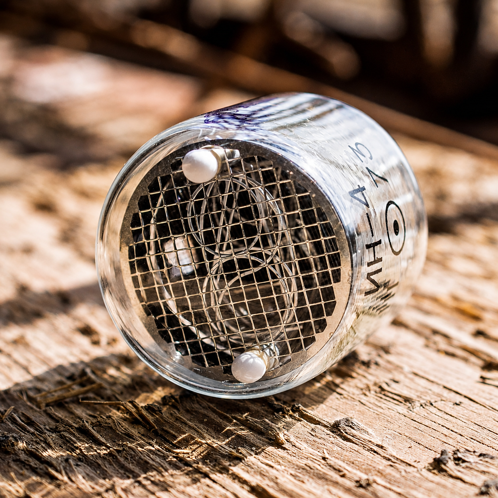
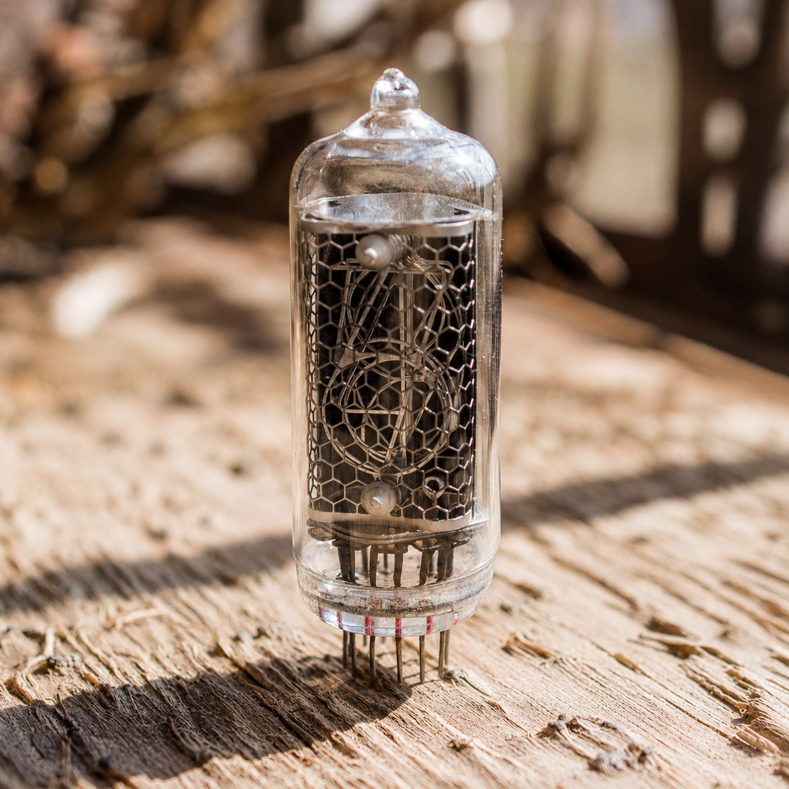
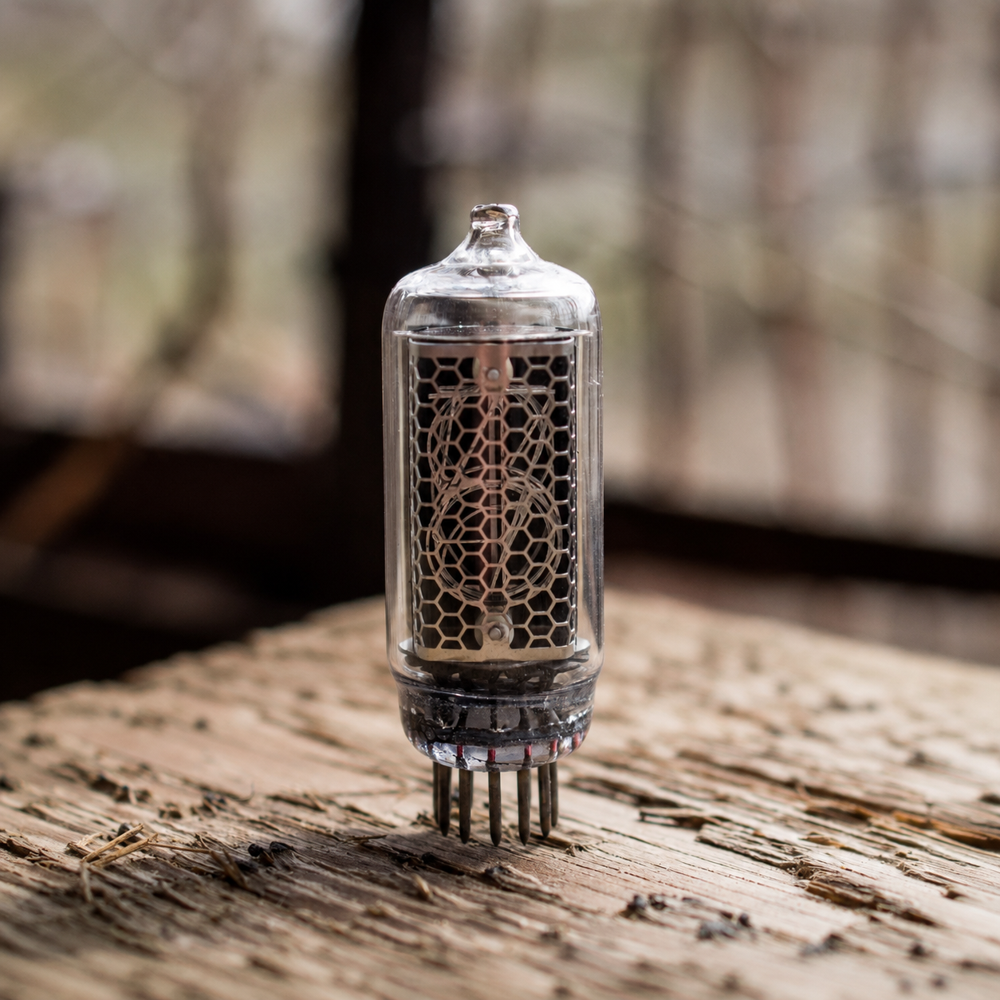
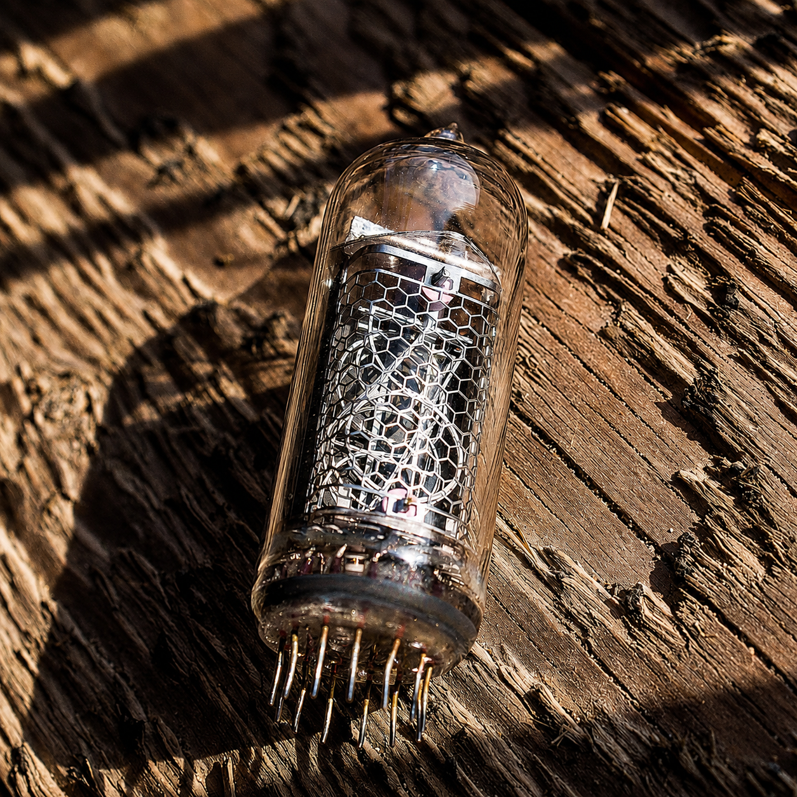
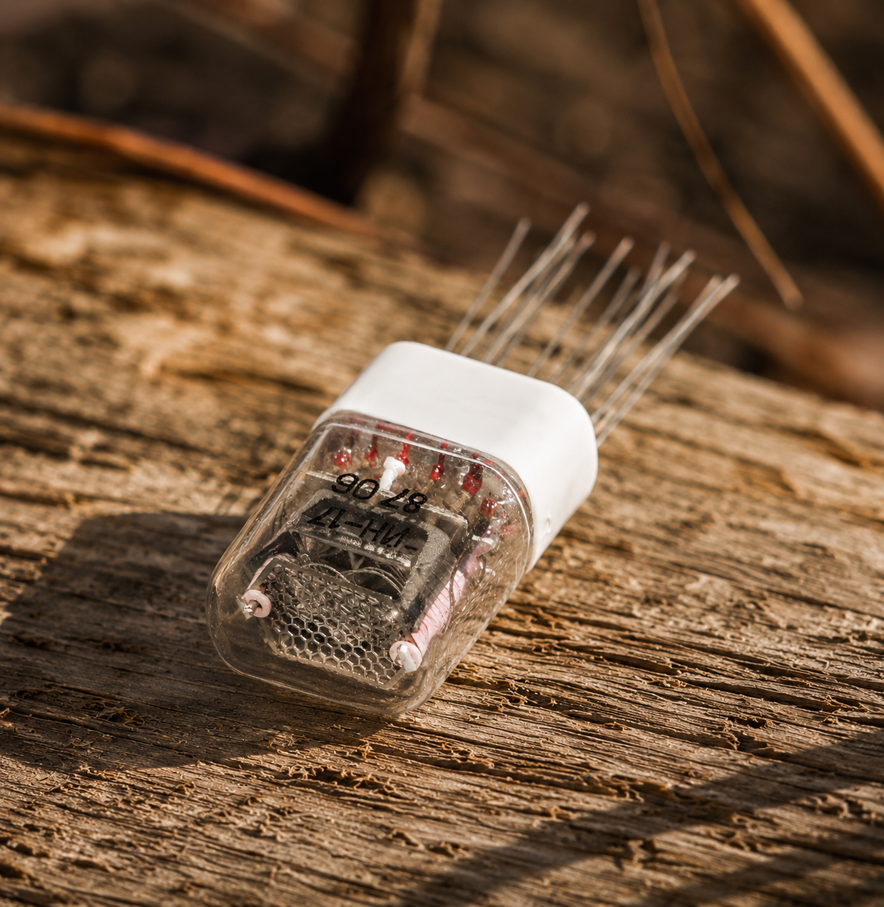
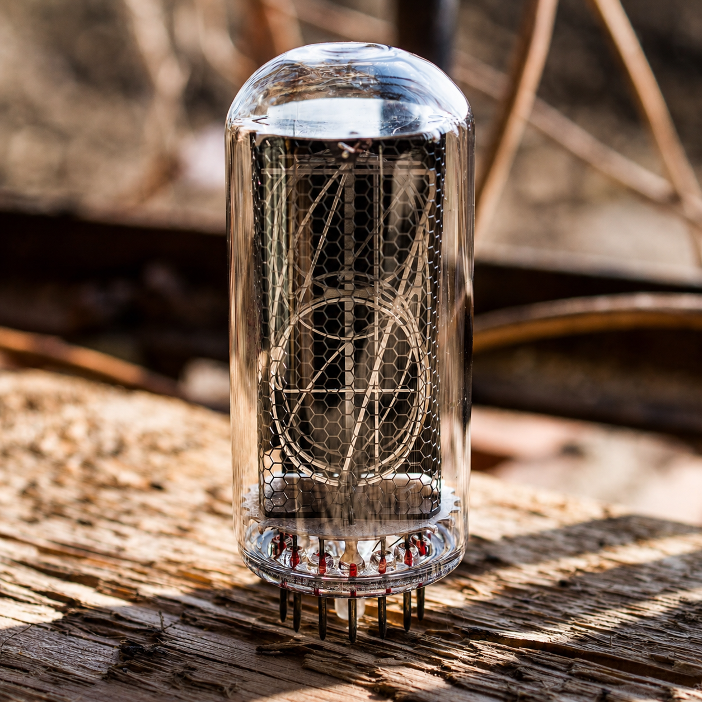

[Главная](../../../README.md) / [Изображения](../../README.md) / [Индикаторы](../README.md) / Советские модели

# 💡 Советские индикаторы

Фотографии моделей из базы проекта. Откройте изображение для просмотра в полном размере. Варианты плат и совместимость: [база индикаторов](../../../common/indicators/README.md).

| Модель | Фотография |
| :---: | :---: |
| **ИН-1** |  |
| **ИН-2** |  |
| **ИН-4** |  |
| **ИН-8-2** |  |
| **ИН-8** |  |
| **ИН-12** |  |
| **ИН-14** |  |
| **ИН-16** |  |
| **ИН-17** |  |
| **ИН-18** |  |
